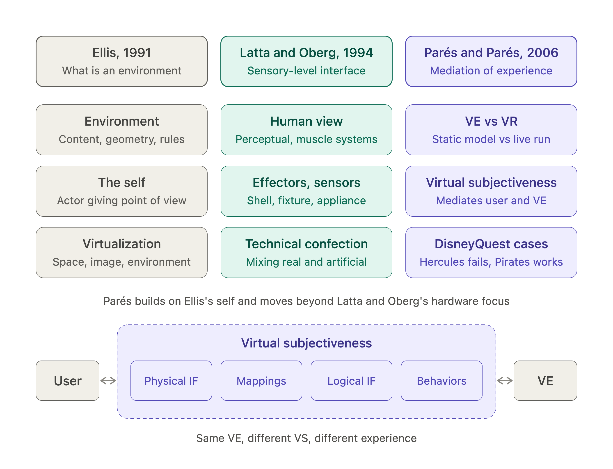

# Summary of Three Papers on Virtual Reality Models

These three papers form a lineage: Ellis (1991) defines what a virtual environment is, Latta & Oberg (1994) model the human–technical system around it, and Parés & Parés (2006) argue both leave a gap and propose a model of the user's _experience_.

---

## 1. Ellis (1991): _Nature and Origins of Virtual Environments: A Bibliographical Essay_

_Computing Systems in Engineering_, 2(4), 321–347.

**Aim:** Treat head-mounted virtual environments (VEs) as a new communication medium, explain what they are, and trace where the technology came from.

### Key ideas

- **Environment = content + geometry + dynamics.**
  - _Content_: objects and actors, described by state vectors (position, orientation, velocity, etc.). The **"self"** is a special actor that provides the point of view.
  - _Geometry_: dimensionality, metrics, and extent of the space.
  - _Dynamics_: the rules of interaction among contents (e.g., Newtonian physics, or grammatical rules).
- **Virtualization** is the process by which a viewer interprets a patterned sensory impression as an extended object in an environment other than where it physically exists. Three levels:
  1. _Virtual space_: a 3D layout inferred from pictorial cues on a flat surface.
  2. _Virtual image_: perceived depth with accommodation, vergence, and stereo cues.
  3. _Virtual environment_: adds head-slaved motion parallax, depth-of-focus variation, and wide field of view, engaging reflexes and giving a sense of telepresence.
- **Viewpoints:** egocentric (inside-out) vs. exocentric (outside-in), which require different tracking behaviors (compensatory vs. pursuit).
- **Origins:**
  - Cave art and literature (Huxley, Gibson)
  - Sutherland's 1960s head-mounted display
  - Krueger's VIDEOPLACE
  - Vehicle and flight simulators
  - 3D cartography
  - Physical and logical simulation
  - Scientific and medical visualization
  - Teleoperation and telerobotics
  - Photography/cinema (Sensorama, LEEP optics, Aspen map)
  - Human-performance engineering models
- **Trade-offs:** cost, stereoscopic eye strain, neck strain from headgear, resolution vs. field of view (eye-tracked high-resolution insets as a possible fix), tracking latency, and motion sickness.

### Conclusion

A full "virtual environment" isn't always the goal. A virtual space or virtual image may be better for some tasks. VEs suit tasks requiring manipulation plus changing viewpoint (e.g., laparoscopic surgery). Mass-market uses are hard to predict (compared to the early personal computer).

---

## 2. Latta & Oberg (1994): _A Conceptual Virtual Reality Model_

_IEEE Computer Graphics & Applications_, 14(1), 23–29.

**Aim:** Provide a definition and conceptual model of VR that goes beyond immersive systems and includes the human participant.

### Key ideas

- **Three-tier definition of VR:**
  - _What_: a computer-based interface to human perceptual and muscle systems.
  - _How_: technology used to create a realistic-seeming environment.
  - _Effect_: either **experiential** (a significant personal experience) or **operational** (performing operations, as in flight simulators).
- **Human view:** Built on J.J. Gibson's perceptual systems (orienting, auditory, haptic, taste-smell, visual) and muscle systems (postural, locomotor, expressive, etc.). The participant connects to the VR system via **effectors** (stimulate the senses) and **sensors** (detect actions). Individual factors (prior experience, ergonomics, sensory sensitivity) matter; Csikszentmihalyi's "flow" is mentioned as an experiential criterion.
- **Three classes of effectors:**
  - _Shells_: stationary enclosures
  - _Fixtures_: environment-fixed devices
  - _Appliances_: worn on the body
- **Technical view:** Introduces the **"technical confection"**, the process of combining real and artificial environments. It includes interface control, environment control (space definition and environment management), mediation, and representation.
- **Confection parameters:** interface mapping, model source (dynamic, constructed, recorded; direct, sampled, modified), and time/space remapping.

### Conclusion

Perceptual equivalence with reality is unrealistic, so VR design involves compromises. The model has implications for networked VR.

---

## 3. Parés & Parés (2006): _Towards a Model for a Virtual Reality Experience: The Virtual Subjectiveness_

_Presence_, 15(5), 524–538.

**Aim:** Fill a gap at a high level of description: how is the user's _experience_ of VR mediated?

### The gap

- Ellis models only the _structure_ of the environment; his "self" is internal to it, with no link to the real user.
- Latta & Oberg stay at a low level, centered on sensors, effectors, and physical interfaces.
- Neither explains how the experience is _mediated_ to the user.

### Key ideas

- **VR as a communication medium**, not just technology. Mediation is unavoidable, so "neutral" or "transparent" interfaces are a false idea.
- **Terminology:**
  - **Virtual Environment (VE)** = the _static_ definition (Ellis's content, geometry, dynamics), analogous to the _model_ of a simulation.
  - **Virtual Reality (VR)** = the VE _put in action_ in real time and experienced by a user, analogous to the _simulation_ itself.
  - VR is defined as interaction with real-time generated digital stimuli. This covers non-simulation and 2D work (e.g., Krueger) and is distinct from telepresence.
- **Multimedia vs. VR (CHI standpoint):** Multimedia is _data recovery_ from prerecorded media; VR is _real-time stimuli generation_ guided by interfaces, mappings, and a model.
- **Interface** is more than physical devices: it includes the **logical (software) interface** and the **mappings** between them (e.g., mouse = physical, cursor = logical).

### The Virtual Subjectiveness (VS)

The mediating entity composed of:

1. **Physical interfaces** (sensors/displays)
2. **Logical interface** (Ellis's "self": viewpoint, representation, capabilities)
3. **Mappings** between them
4. **Behaviors** (how the logical interface can explore, manipulate, or contribute to the VE)

### Examples of its effect

- The same forest VE feels completely different with a 1:1 vs. 1:2 head-rotation mapping (the "owl" example).
- Treadmill mappings change the perceived scale of the world.
- Adding collisions or manipulation abilities changes the experience even though the VE is unchanged.

### Preliminary design framework (3 layers)

1. **Application:** focus, content, context, target users
2. **Define user unfolding:** capabilities, feedback, perception filters
3. **Configuration:** physical interfaces, logical interfaces, mappings, behaviors

### Case studies (DisneyQuest)

| Attraction                                            | VS design    | Why                                                                                                                                                                   |
| ----------------------------------------------------- | ------------ | --------------------------------------------------------------------------------------------------------------------------------------------------------------------- |
| _Hercules in the Underworld_                          | **Flawed**   | Four joysticks and four characters suggest individual exploration, but a single shared view forces the group to move together. Two clashing strategies confuse users. |
| _Pirates of the Caribbean: Battle for Buccaneer Gold_ | **Coherent** | One clear entity ("the ship") with consistent mappings (helm → rudder, cannons → virtual cannons, hull → motion platform). Users' mental models match the VS.         |

### Argument against presence

The VS model is deliberately not tied to "sense of presence," which is not always desirable, has not been shown to correlate with task performance, and applies mainly to fidelity-based simulations.

### Conclusion

The same VE can yield different experiences by changing the VS. The model is technology-independent and not restricted to simulation, but it is preliminary and needs further detail to become a full design and analysis tool.

---

## How they connect

|                            | Ellis 1991                             | Latta & Oberg 1994                              | Parés & Parés 2006                                         |
| -------------------------- | -------------------------------------- | ----------------------------------------------- | ---------------------------------------------------------- |
| **Focus**                  | Structure of the environment + history | Human/technical system, perception & interfaces | User's _experience_ and its mediation                      |
| **Level**                  | Environment definition                 | Low-level sensorial/physical                    | High-level, semantic/cognitive                             |
| **Key concept**            | Content, geometry, dynamics; "self"    | Confection model; shells/fixtures/appliances    | Virtual Subjectiveness (interfaces + mappings + behaviors) |
| **Limitation (per Parés)** | "Self" not linked to the actual user   | Tied to physical interfaces                     | Preliminary; framework still to be detailed                |

